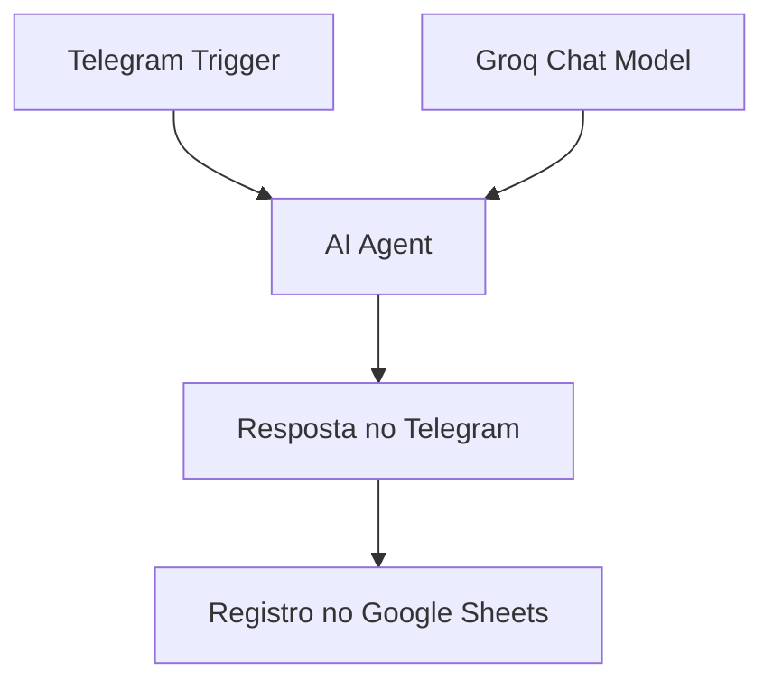

# Assistente de estudos de TI com n8n e Telegram

Fluxo de automação que recebe dúvidas de tecnologia pelo Telegram, gera uma resposta com um modelo da **Groq** e registra a interação no Google Sheets.

## O que o projeto demonstra

- Orquestração visual de serviços com n8n.
- Integração entre mensageria, modelo de linguagem e planilha.
- Expressões JavaScript para mapear dados entre nós e formatar datas.
- Configuração de credenciais fora do arquivo público.

## Fluxo



O JSON usa `lmChatGroq` e autenticação Google por **conta de serviço**. Groq é o provedor; não confundir com Grok, modelo da xAI. A descrição anterior de OAuth2 não correspondia à configuração exportada.

## Arquivos

| Arquivo | Função |
| --- | --- |
| [bot-estudos-ti.json](bot-estudos-ti.json) | Fluxo importável, inativo e sem vínculos de credenciais |
| [test/workflow.test.js](test/workflow.test.js) | Verificações estruturais locais |

## Configuração

1. Importe `bot-estudos-ti.json` em uma instância n8n que ofereça os tipos e versões de nós presentes no arquivo. Revise avisos de compatibilidade antes de ativar.
2. Crie um bot pelo BotFather e configure uma credencial Telegram no n8n. Selecione-a no gatilho e no nó de envio.
3. Configure uma credencial Groq e selecione-a em **Groq Chat Model**. O modelo exportado é `meta-llama/llama-4-scout-17b-16e-instruct`; confira sua disponibilidade na conta e escolha outro modelo suportado se necessário.
4. Crie uma planilha com a aba `Página1` e os cabeçalhos exatos `Data`, `Pergunta` e `Resposta`.
5. Configure a credencial Google por conta de serviço no n8n e habilite o acesso à API Google Sheets no projeto Google Cloud. Compartilhe somente a planilha de destino com o e-mail dessa conta, com permissão de edição.
6. No nó **Append row in sheet**, selecione a credencial, substitua `SUBSTITUA_PELO_ID_DA_PLANILHA` pelo ID da sua planilha e confira a aba e o mapeamento das colunas.
7. Configure a URL pública HTTPS do n8n para o webhook do Telegram. Evite usar o mesmo token em dois fluxos ativos.
8. Execute o teste manual abaixo antes de ativar o fluxo.

Não publique tokens, chaves da conta de serviço, dados de conversas ou exportações com dados fixados. O arquivo público remove vínculos locais; credenciais devem ser selecionadas novamente após importar.

## Teste manual

Envie uma pergunta curta, como “O que é uma chave primária?”. Verifique:

- O gatilho recebe `message.text` e o identificador do chat.
- O agente produz `output`.
- O Telegram recebe a resposta.
- A planilha recebe uma linha com a pergunta, a resposta enviada e a data.

A data vem do retorno do envio no Telegram e usa a localidade `pt-PT`; o fuso não é fixado pela expressão. Configure-o conforme o uso desejado.

## Verificação local sem credenciais

Com Node.js 18 ou superior:

```bash
git clone https://github.com/jessicafmaximiano/n8n-telegram-ai-bot.git
cd n8n-telegram-ai-bot
node --test
```

Os testes verificam integridade de conexões e sanitização do modelo. Não executam n8n nem comprovam integração com os serviços.

## Limitações atuais

- O fluxo espera mensagens de texto; não trata áudio, fotos ou anexos.
- Não possui memória de conversa nem base de conhecimento para recuperação.
- Não há divisão de respostas longas, controle de acesso por usuário ou limite de requisições no fluxo.
- O envio remove parte da pontuação da resposta; isso pode prejudicar exemplos de código.
- O registro na planilha ocorre depois do envio. Se a gravação falhar, a resposta pode ter sido enviada sem registro.
- Ainda não há rota dedicada de erro ou retentativa. Mapeamento de dados não equivale a tratamento completo de falhas.
- Respostas de IA podem estar incorretas; revise exemplos antes de utilizá-los.

As conversas são encaminhadas aos serviços configurados e registradas na planilha. Restrinja acesso e defina um prazo de retenção adequado ao seu uso.

## Próximos passos

Filtrar entradas sem texto, preservar blocos de código, tratar respostas longas e adicionar uma rota de falha são melhorias planejadas, ainda não implementadas.
